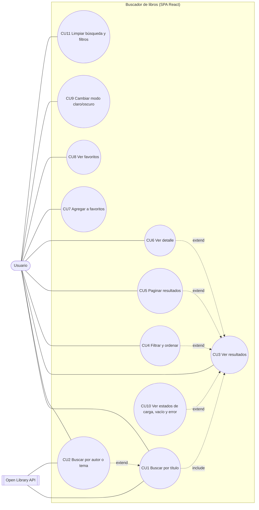
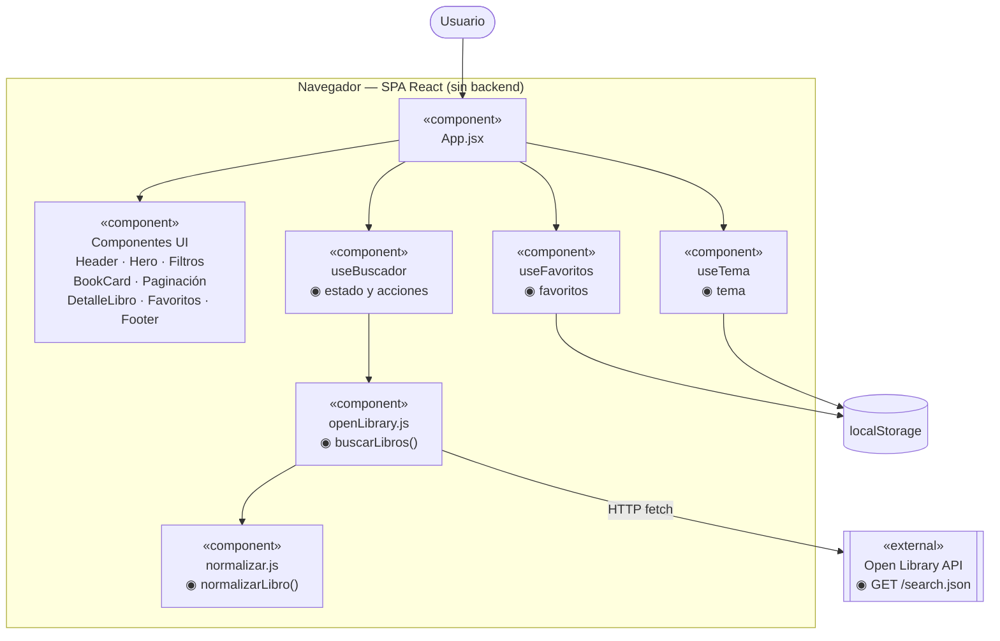

# Casos de uso — Buscador de libros (Open Library API)

Aplicación **100% frontend**: una SPA en React que consume la API pública de
Open Library directamente desde el navegador con `fetch`. No hay servidor
propio, base de datos ni proxy.

## Actores

| Actor | Tipo | Descripción |
|---|---|---|
| Usuario | Primario | Visitante que busca, filtra y guarda libros. |
| Open Library | Secundario (externo) | API pública de solo lectura (`GET /search.json`). |
| Sistema | Secundario | La SPA: estados, normalización y persistencia local. |

## Diagrama de casos de uso

> `include`: el comportamiento ocurre **siempre**.
> `extend`: el comportamiento ocurre **solo bajo una condición**, en un punto
> de extensión definido.

---

## CU1 — Buscar libros por título

- **Actores:** Usuario, Open Library API.
- **Precondición:** la aplicación está cargada y hay conexión.
- **Flujo principal:**
  1. El usuario escribe un título en el buscador.
  2. El Sistema espera 350 ms de inactividad (debounce).
  3. El Sistema hace `GET /search.json?q=<título>&limit=12&offset=0`.
  4. La API responde con `docs` y `numFound`.
  5. El Sistema normaliza los datos y muestra las tarjetas (CU3).
- **Flujos alternativos:**
  - El usuario presiona «Buscar»: la búsqueda se ejecuta sin esperar el debounce.
  - El campo está vacío: se muestran los libros destacados por defecto.
- **Excepciones:** la API falla o no hay conexión → CU10.
- **Criterios de aceptación:**
  - No se envía más de una petición por pausa de escritura.
  - Cada tarjeta muestra portada, título, autor, año, categoría, ISBN y resumen.

## CU2 — Buscar por autor o tema (`extend` de CU1)

- **Actores:** Usuario, Open Library API.
- **Punto de extensión:** «especificar criterio de búsqueda».
- **Condición:** el usuario escribe el nombre de un autor o un tema en el mismo
  campo de búsqueda.
- **Flujo principal:** el texto se envía igual que en CU1 y Open Library busca en
  todos sus campos indexados.
- **Criterios de aceptación:** el mensaje de resultados indica el término usado.

## CU3 — Ver resultados de búsqueda (`include` de CU1)

- **Actores:** Usuario, Sistema.
- **Precondición:** existe una respuesta válida de la API.
- **Flujo principal:**
  1. El Sistema convierte cada `doc` al modelo único de libro.
  2. Renderiza una grilla responsiva de tarjetas.
  3. Muestra el contador: `N resultado(s) para "<término>"`.
- **Excepciones:** `docs` ausente o malformado → se trata como lista vacía.
- **Criterios de aceptación:** cada tarjeta usa una `key` única (`doc.key`).

## CU4 — Filtrar y ordenar resultados (`extend` de CU3)

- **Actores:** Usuario.
- **Punto de extensión:** «refinar resultados».
- **Condición:** el usuario cambia categoría, idioma, año u orden.
- **Flujo principal:**
  1. El Sistema reinicia la paginación a la primera página.
  2. Envía `subject`, `lang` y `first_publish_year` cuando corresponda.
  3. Aplica el orden elegido sobre los resultados cargados.
- **Flujos alternativos:**
  - «Limpiar filtros» → CU11.
  - Sin coincidencias → CU10 (estado vacío).
- **Criterios de aceptación:**
  - Opciones de orden: relevancia, año (reciente/antiguo) y título A–Z.
  - El orden es local: afecta a los resultados ya cargados.

## CU5 — Paginar resultados (`extend` de CU3)

- **Actores:** Usuario.
- **Punto de extensión:** «ver más resultados».
- **Condición:** `libros.length < numFound` y el usuario pulsa «Cargar más».
- **Flujo principal:**
  1. El Sistema pide `offset = libros.length`.
  2. Agrega las nuevas tarjetas al final sin borrar las anteriores.
- **Excepciones:** falla la carga → mensaje inline y se conservan los resultados.
- **Criterio de aceptación:** el botón desaparece cuando no quedan resultados.

## CU6 — Ver detalle de un libro (`extend` de CU3)

- **Actores:** Usuario.
- **Punto de extensión:** «abrir ficha de un libro».
- **Condición:** hay resultados visibles y el usuario pulsa «Detalles».
- **Flujo principal:**
  1. Se abre un modal con portada grande y todos los campos.
  2. Se ofrece el enlace «Ver en Open Library» en una pestaña nueva.
- **Flujos alternativos:** cerrar con Escape, con el botón de cierre o clic fuera.
- **Criterios de aceptación:**
  - `role="dialog"` y `aria-modal="true"`.
  - El foco entra al modal y vuelve al elemento anterior al cerrar.

## CU7 — Agregar o quitar favoritos

- **Actores:** Usuario.
- **Flujo principal:**
  1. El usuario pulsa el botón de favorito en una tarjeta o en el detalle.
  2. El Sistema guarda o elimina el libro en `localStorage`.
  3. El contador del menú se actualiza.
- **Criterios de aceptación:**
  - El estado se conserva al recargar la página.
  - El botón expone `aria-pressed`.

## CU8 — Ver favoritos

- **Actores:** Usuario.
- **Precondición:** puede haber cero o más favoritos guardados.
- **Flujo principal:**
  1. El usuario pulsa «Favoritos» en el menú.
  2. El Sistema muestra la grilla de favoritos guardados.
- **Flujo alternativo:** sin favoritos → mensaje y botón «Volver a buscar».
- **Criterios de aceptación:** se puede abrir el detalle y quitar favoritos.

## CU9 — Cambiar modo claro/oscuro

- **Actores:** Usuario.
- **Flujo principal:**
  1. El usuario pulsa el botón de tema.
  2. El Sistema alterna `data-tema` en `<html>` y guarda la preferencia.
- **Criterio de aceptación:** la preferencia se mantiene al recargar y todo el
  texto conserva contraste legible.

## CU10 — Ver estados de carga, vacío y error (`extend` de CU3)

- **Actores:** Usuario, Sistema.
- **Punto de extensión:** «mostrar estado de la consulta».
- **Condiciones y flujos:**
  - **Carga:** mientras se espera la primera respuesta se muestra un spinner.
  - **Cargando más:** se muestra un indicador inline sin ocultar la grilla.
  - **Vacío:** la API devuelve 0 resultados → mensaje con opción de limpiar.
  - **Error:** falla la red o la API responde 5xx → mensaje claro y botón
    «Reintentar» que repite la petición con los mismos parámetros.
- **Criterios de aceptación:**
  - Una respuesta antigua nunca reemplaza a una búsqueda más reciente
    (`AbortController`).
  - La aplicación no se rompe ante una respuesta inesperada.

## CU11 — Limpiar búsqueda y filtros

- **Actores:** Usuario.
- **Flujo principal:** al pulsar «Limpiar» se vacía el término, se reinician los
  filtros y el orden, y se vuelve a los libros destacados.
- **Criterio de aceptación:** se restaura el estado inicial en un solo clic.

---

## Diagrama de componentes

Muestra de qué módulos está hecha la SPA y cómo se conectan. Las interfaces
provistas se indican con el nombre debajo de cada componente; las dependencias,
con flechas.

### Notación

- **Componente:** módulo con responsabilidad propia (`App.jsx`, hooks, API).
- **Interfaz provista (◉):** lo que el componente ofrece a los demás.
- **Interfaz requerida:** la flecha indica de qué componente depende.
- **Actor externo:** Open Library, fuera de la aplicación.
- **Almacenamiento:** `localStorage` para favoritos y tema (sin backend).

### Responsabilidades

| Componente | Responsabilidad |
|---|---|
| `App.jsx` | Componer la vista y conectar hooks con componentes. |
| `useBuscador` | Debounce, `AbortController`, filtros, orden, paginación y estados. |
| `useFavoritos` | Leer y escribir favoritos en `localStorage`. |
| `useTema` | Alternar y persistir el tema claro/oscuro. |
| `openLibrary.js` | Construir la URL y ejecutar `fetch`. |
| `normalizar.js` | Convertir `doc` de Open Library al modelo único. |
| Componentes UI | Presentación y accesibilidad (formularios, tarjetas, modal). |
